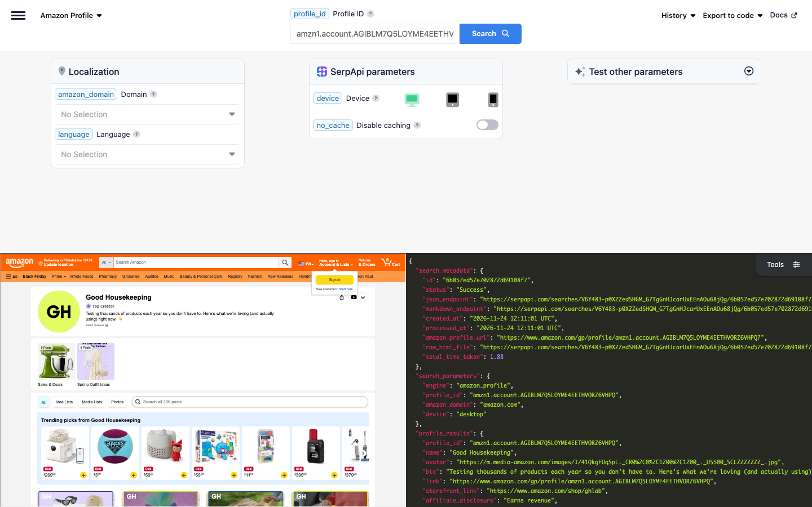

# Amazon Profile Scraper

Scrape Amazon profiles with SerpApi's Amazon Profile API. Look up the public Amazon profile of a reviewer, creator, or publisher by its profile ID, and get its name, avatar, bio, and link, the storefront link, earnings disclosure, and social links of Amazon influencers, its posts, i.e., Idea Lists of recommended products, photos, and videos, with their likes and the ASINs of the products they feature, and the reviews written on the requested Amazon domain, with their rating, helpful votes, images, and reviewed product.

## How to scrape Amazon profiles

Get an Amazon profile with a simple GET request:

```text
https://serpapi.com/search?engine=amazon_profile&profile_id=amzn1.account.AGIBLM7Q5LOYME4EETHVORZ6VHPQ&api_key=SERPAPI_API_KEY
```

- `profile_id` is the Amazon profile ID, `amzn1.account.` followed by 28 uppercase letters and digits, e.g., `amzn1.account.AGIBLM7Q5LOYME4EETHVORZ6VHPQ` for Good Housekeeping. It's the ID in a profile's `/gp/profile/` link, which Amazon links from the author's name on every review, and the reviews in the [Amazon Product API](https://serpapi.com/amazon-product-api?utm_source=github_amazon_profile_scraper) results link to this API in `serpapi_amazon_profile_link`. For a storefront, e.g., `https://www.amazon.com/shop/ghlab`, the ID is in the page's HTML, in the `data-entity-id` of the Follow button.
- `api_key` is your SerpApi API key. Replace `SERPAPI_API_KEY` with it.
- `amazon_domain` sets the Amazon domain, e.g., `amazon.co.uk`. It defaults to `amazon.com`. Reviews and posts are per marketplace: a profile lists the reviews written and the posts published on the requested domain.
- `language` sets the language of the page, e.g., `es_US` for Spanish on amazon.com. It translates the helpful votes and product titles, not the reviews.

Amazon sends visitors of a brand's, publisher's, or influencer's profile to its storefront, and the response then has the `storefront_link` and the storefront's posts. Brand and publisher storefronts, e.g., Good Housekeeping's, have no reviews. A profile without reviews or posts on the requested domain, e.g., an amazon.com reviewer on `amazon.co.uk`, has only `profile_results`, without an error.

[Register at SerpApi](https://serpapi.com?utm_source=github_amazon_profile_scraper) to get your API key, and keep it private.

### Playground

Try the request live in the [SerpApi Playground](https://serpapi.com/playground?engine=amazon_profile&profile_id=amzn1.account.AGIBLM7Q5LOYME4EETHVORZ6VHPQ&utm_source=github_amazon_profile_scraper).

[](https://serpapi.com/playground?engine=amazon_profile&profile_id=amzn1.account.AGIBLM7Q5LOYME4EETHVORZ6VHPQ&utm_source=github_amazon_profile_scraper)

## Code examples

The code examples read your API key from the `SERPAPI_API_KEY` environment variable:

```bash
export SERPAPI_API_KEY="SERPAPI_API_KEY"
```

Each example gets Good Housekeeping's Amazon profile and prints its name and storefront link, followed by the type, title, and number of products of each post.

### curl integration

Send the request with curl, which prints the full JSON response:

```bash
curl --get https://serpapi.com/search \
 --data-urlencode engine="amazon_profile" \
 --data-urlencode profile_id="amzn1.account.AGIBLM7Q5LOYME4EETHVORZ6VHPQ" \
 --data-urlencode api_key="$SERPAPI_API_KEY"
```

### JavaScript integration

Install the [SerpApi JavaScript library](https://github.com/serpapi/serpapi-javascript) and set your project to use ES modules:

```bash
npm install serpapi
npm pkg set type=module
```

Create an `index.js` file:

```javascript
import { getJson } from "serpapi";

const results = await getJson({
  engine: "amazon_profile",
  api_key: process.env.SERPAPI_API_KEY,
  profile_id: "amzn1.account.AGIBLM7Q5LOYME4EETHVORZ6VHPQ",
});

const profile = results.profile_results ?? {};
console.log(profile.name, profile.storefront_link ?? "");
for (const post of results.posts ?? []) {
  console.log(post.type, post.title ?? "", (post.products ?? []).length);
}
```

Run it with `node index.js`.

### Python integration

Install the [SerpApi Python library](https://github.com/serpapi/serpapi-python):

```bash
pip install serpapi
```

Create a `main.py` file:

```python
import os
import serpapi

client = serpapi.Client(api_key=os.getenv("SERPAPI_API_KEY"))
results = client.search({
    "engine": "amazon_profile",
    "profile_id": "amzn1.account.AGIBLM7Q5LOYME4EETHVORZ6VHPQ",
})

profile = results.get("profile_results", {})
print(profile.get("name"), profile.get("storefront_link", ""))
for post in results.get("posts", []):
    print(post["type"], post.get("title", ""), len(post.get("products", [])))
```

Run it with `python main.py`.

### Ruby integration

Install the [SerpApi Ruby library](https://github.com/serpapi/serpapi-ruby):

```bash
gem install serpapi
```

Create a `main.rb` file:

```ruby
require "serpapi"

client = SerpApi::Client.new(engine: "amazon_profile", api_key: ENV.fetch("SERPAPI_API_KEY"))
results = client.search(profile_id: "amzn1.account.AGIBLM7Q5LOYME4EETHVORZ6VHPQ")

profile = results.fetch(:profile_results, {})
puts "#{profile[:name]} #{profile[:storefront_link]}"
results.fetch(:posts, []).each do |post|
  puts "#{post[:type]} #{post[:title]} #{post.fetch(:products, []).length}"
end

client.close
```

Run it with `ruby main.rb`.

### PHP integration

Install the [SerpApi PHP library](https://github.com/serpapi/serpapi-php):

```bash
composer require serpapi/serpapi-php
```

Create an `index.php` file:

```php
<?php
require 'vendor/autoload.php';

use SerpApi\Client;

$client = new Client(getenv('SERPAPI_API_KEY'), 'amazon_profile');
$results = $client->search([
  'profile_id' => 'amzn1.account.AGIBLM7Q5LOYME4EETHVORZ6VHPQ',
]);

$profile = $results->profile_results ?? null;
echo ($profile->name ?? '') . ' ' . ($profile->storefront_link ?? '') . PHP_EOL;
foreach ($results->posts ?? [] as $post) {
  echo $post->type . ' ' . ($post->title ?? '') . ' ' . count($post->products ?? []) . PHP_EOL;
}
```

Run it with `php index.php`.

### Go integration

Create a Go module and install the [SerpApi Go library](https://github.com/serpapi/serpapi-golang):

```bash
go mod init example.com/profile
go get github.com/serpapi/serpapi-golang
```

Create a `main.go` file:

```go
package main

import (
	"fmt"
	"os"

	"github.com/serpapi/serpapi-golang"
)

func main() {
	setting := serpapi.NewSerpApiClientSetting(os.Getenv("SERPAPI_API_KEY"))
	setting.Engine = "amazon_profile"
	client := serpapi.NewClient(setting)

	results, err := client.Search(map[string]string{
		"profile_id": "amzn1.account.AGIBLM7Q5LOYME4EETHVORZ6VHPQ",
	})
	if err != nil {
		panic(err)
	}

	profile, _ := results["profile_results"].(map[string]interface{})
	storefrontLink, _ := profile["storefront_link"].(string)
	fmt.Println(profile["name"], storefrontLink)
	posts, _ := results["posts"].([]interface{})
	for _, item := range posts {
		post := item.(map[string]interface{})
		title, _ := post["title"].(string)
		products, _ := post["products"].([]interface{})
		fmt.Println(post["type"], title, len(products))
	}
}
```

Run it with `go run .`.

### Rust integration

Create a Cargo project and add the [SerpApi Rust library](https://github.com/serpapi/serpapi-rust) and Tokio:

```bash
cargo new profile && cd profile
cargo add serpapi tokio --features tokio/full
```

Replace `src/main.rs` with:

```rust
use serpapi::serpapi::Client;
use std::collections::HashMap;
use std::env;

#[tokio::main]
async fn main() -> Result<(), Box<dyn std::error::Error>> {
    let mut default = HashMap::new();
    default.insert("api_key".to_string(), env::var("SERPAPI_API_KEY")?);
    default.insert("engine".to_string(), "amazon_profile".to_string());
    let client = Client::new(default)?;

    let mut parameter = HashMap::new();
    parameter.insert(
        "profile_id".to_string(),
        "amzn1.account.AGIBLM7Q5LOYME4EETHVORZ6VHPQ".to_string(),
    );

    let results = client.search(parameter).await?;
    let profile = &results["profile_results"];
    println!(
        "{} {}",
        profile["name"].as_str().unwrap_or_default(),
        profile["storefront_link"].as_str().unwrap_or_default()
    );
    if let Some(posts) = results["posts"].as_array() {
        for post in posts {
            println!(
                "{} {} {}",
                post["type"].as_str().unwrap_or_default(),
                post["title"].as_str().unwrap_or_default(),
                post["products"]
                    .as_array()
                    .map_or(0, |products| products.len())
            );
        }
    }
    Ok(())
}
```

Run it with `cargo run`.

### Other programming languages

Official libraries are also available for [Java](https://github.com/serpapi/serpapi-java), [.NET](https://github.com/serpapi/serpapi-dotnet), [Swift](https://github.com/serpapi/serpapi-swift), and [C++](https://github.com/serpapi/serpapi-cpp). See [SerpApi integrations](https://serpapi.com/integrations?utm_source=github_amazon_profile_scraper) for setup guides, or use a simple GET request from any programming language.

### Errors

Failed requests return an HTTP error status and a JSON body with an `error` message. The most common are `401` for an invalid API key, `400` for a missing required parameter such as `profile_id`, and `429` when you exceed your hourly throughput limit or run out of searches. Invalid values also return `400`, e.g., "Invalid `foo` profile ID - profile_id parameter.", which you also get for an ID without the `amzn1.account.` prefix or in lowercase. See [API status and error codes](https://serpapi.com/api-status-and-error-codes?utm_source=github_amazon_profile_scraper) for the full list.

A request without a profile still returns `200`, with `search_metadata.status` set to `Success`, `search_information.profile_results_state` set to `Fully empty`, and the error "Amazon Profile hasn't returned any results for this query.", so check for `error` before reading `profile_results`. This happens for a profile ID in the right format that doesn't exist, e.g., `amzn1.account.AAAAAAAAAAAAAAAAAAAAAAAAAAAA`.

## Output formats: JSON and Markdown

Choose structured JSON for applications or Markdown for LLMs and AI agents:

- JSON is the default output and is useful when you need individual result fields.
- Add `output=md` to receive Markdown instead, which is more token-efficient.

Markdown is plain text, not JSON: YAML front matter with the search metadata, followed by the details of the profile as a list with its social links, a table of its reviews with their title, text, rating, helpful votes, product, and images, and a table of its posts with their ID, type, likes, thumbnail, linked title, and number of items. It doesn't include the products of each post. Read the response body as text instead of parsing it.

| Client | Markdown request |
|--------|------------------|
| curl | `--data-urlencode output="md"` |
| Python | `client.search({..., "output": "md"})` |
| PHP | `$client->md([...])` |
| Go | `client.Md(map[string]string{...})` |
| Rust | `client.md(parameter).await?` |

If your SDK doesn't have a Markdown helper yet, send a plain HTTP request with `output=md` and read the body as text. Learn more about [Markdown output](https://serpapi.com/markdown-output?utm_source=github_amazon_profile_scraper).

## Amazon Profile API parameters

See the [Amazon Profile API documentation](https://serpapi.com/amazon-profile-api?utm_source=github_amazon_profile_scraper) for more details.

| Name | Description | Requirement |
|------|-------------|-------------|
| **Search query** | | |
| `profile_id` | The Amazon profile ID, `amzn1.account.` followed by 28 uppercase letters and digits (e.g., `amzn1.account.AGIBLM7Q5LOYME4EETHVORZ6VHPQ` for Good Housekeeping). It's the ID in the profile's `/gp/profile/` link, which Amazon links from the author's name on every review, and it's in the `serpapi_amazon_profile_link` of the reviews in the Amazon Product API results. An ID without the `amzn1.account.` prefix or in lowercase returns a `400` error. | Required |
| **Localization** | | |
| `amazon_domain` | The Amazon domain to use (e.g., `amazon.co.uk`). Defaults to `amazon.com`. Reviews and posts are per marketplace: a profile lists the reviews written and the posts published on the requested domain, and the links lead to that domain. See [Amazon domains](https://serpapi.com/amazon-domains?utm_source=github_amazon_profile_scraper) for the full list. `amazon.cn` isn't supported. | Optional |
| `language` | The language of the page, as a locale (e.g., `en_US` or `es_US` on amazon.com, or `ja_JP` on amazon.co.jp). It translates the helpful votes and product titles, not the reviews. Without it, the language depends on the domain, e.g., English on amazon.co.jp, amazon.de, and amazon.eg, Spanish on amazon.com.mx, and Turkish on amazon.com.tr. Amazon ignores a language the domain doesn't offer, e.g., `fr_FR` on amazon.com. See [Amazon languages](https://serpapi.com/amazon-languages?utm_source=github_amazon_profile_scraper) for the languages of each domain. | Optional |
| **SerpApi parameters** | | |
| `engine` | Set to `amazon_profile`. | Required |
| `api_key` | Your private SerpApi API key. | Required |
| `device` | Set to `desktop` (default), `tablet`, or `mobile`. On `mobile`, Idea Lists have no `thumbnail`. | Optional |
| `no_cache` | Set to `true` to request fresh results instead of using the one-hour cache. Can't be combined with `async`. | Optional |
| `async` | Set to `true` for later retrieval through the [Searches Archive API](https://serpapi.com/search-archive-api?utm_source=github_amazon_profile_scraper). Can't be combined with `no_cache` or used with Ludicrous Speed enabled. | Optional |
| `zero_trace` | Enterprise only. Set to `true` to skip storing search parameters, files, and metadata on SerpApi servers. | Optional |
| `output` | Set to `json` (default), `html` for the raw HTML retrieved from Amazon, e.g., the storefront page for Good Housekeeping, or `md` for Markdown. | Optional |
| `json_restrictor` | Limit the JSON response to the fields you need. See the [JSON Restrictor](https://serpapi.com/json-restrictor?utm_source=github_amazon_profile_scraper) documentation. | Optional |

## Available data on Amazon profiles (JSON response)

`profile_results` describes the profile, `posts` lists up to 20 of its posts with up to 20 of the products each one features, and `reviews` lists up to 30 of its reviews on the requested domain. The field guides below describe the possible fields and their types; they aren't literal API responses.

### What you get depends on the profile

Some fields appear only when Amazon shows them:

| Profile | Fields |
|---------|--------|
| A brand, publisher, or influencer with a storefront, e.g., Good Housekeeping | `storefront_link`, e.g., `https://www.amazon.com/shop/ghlab`, and `affiliate_disclosure`, e.g., Earns revenue |
| A profile with links to its social accounts | `social_links`, e.g., the YouTube, Instagram, TikTok, and Pinterest accounts of Good Housekeeping |
| A profile with a bio | `bio`, e.g., Testing thousands of products each year so you don’t have to. Here’s what we’re loving (and actually using) right now. 👇 |
| A profile with Idea Lists | `posts` with the `type` Idea List, a `title`, e.g., Best New Toys of 2026 on Amazon, and `items`, the number of products in the list, e.g., 57 |
| A profile with photos or videos | `posts` with the `type` Photo or Video, without `title` and `items`. Videos have no `link` |
| A reviewer with reviews on the requested domain | `reviews`. The first ones, which Amazon embeds in the profile page, e.g., 20 of 29, have `helpful_votes`, `product.title`, and all their `images`. The others have at most their first image. On amazon.com.mx, amazon.com.tr, and amazon.eg, every review is embedded |
| An influencer with reviews | `reviews` without `helpful_votes` and `product.title`, because the storefront doesn't embed them |
| A review with text | `text`. Reviews with only a title and a rating have none |

Each review has a `review_id`, and its `link` leads to the review on Amazon, which asks signed-out visitors to sign in. Each post has a `post_id`, which starts with `amzn1.ideas.` for Idea Lists, `amzn1.shoppablemedia.v1.` for photos, and `amzn1.vse.video.` for videos, and Idea Lists and photos have a `link` to the post, e.g., `https://www.amazon.com/shop/ghlab/list/1S3YV9L4FFVHZ`. Each product has its `asin` and a `link` to its product page, e.g., `https://www.amazon.com/dp/B0GSC7TDD2`, so you can look it up with the Amazon Product API. The response has no prices and no pagination.

### Profile

`profile_results` describes the profile:

```json
{
  "profile_results": {
    "profile_id": "String - Amazon profile ID, e.g., amzn1.account.AGIBLM7Q5LOYME4EETHVORZ6VHPQ",
    "name": "String - Name of the profile, e.g., Good Housekeeping",
    "avatar": "String - Link to the profile picture, or to Amazon's placeholder image when there's none",
    "bio": "String - Bio of the profile",
    "link": "String - Link to the profile on the requested Amazon domain, e.g., https://www.amazon.com/gp/profile/amzn1.account.AGIBLM7Q5LOYME4EETHVORZ6VHPQ",
    "storefront_link": "String - Link to the storefront Amazon shows instead of the profile, e.g., https://www.amazon.com/shop/ghlab",
    "affiliate_disclosure": "String - Amazon's earnings disclosure on the storefront, e.g., Earns revenue",
    "social_links": "Array[String] - Links to the social accounts of the profile, e.g., https://www.instagram.com/goodhousekeeping"
  }
}
```

### Posts

Each post in `posts` can include these fields:

```json
{
  "posts": [
    {
      "position": "Integer - Position of the post on the profile",
      "post_id": "String - Amazon ID of the post, e.g., amzn1.ideas.1S3YV9L4FFVHZ",
      "type": "String - Type of the post: Idea List, Photo, or Video",
      "title": "String - Title of the Idea List, e.g., Best New Toys of 2026 on Amazon",
      "items": "Integer - Number of products in the Idea List, e.g., 57",
      "likes": "Integer - Number of likes of the post, e.g., 344",
      "link": "String - Link to the post on Amazon, e.g., https://www.amazon.com/shop/ghlab/list/1S3YV9L4FFVHZ",
      "thumbnail": "String - Link to the image of the post",
      "products": [
        {
          "asin": "String - ASIN of a product the post features, e.g., B0GSC7TDD2",
          "link": "String - Link to the product on Amazon, e.g., https://www.amazon.com/dp/B0GSC7TDD2",
          "thumbnail": "String - Link to the image of the product"
        }
      ]
    }
  ]
}
```

`products` has up to 20 of the products of an Idea List, so it can have fewer than `items`, e.g., 20 of the 57 products of Best New Toys of 2026 on Amazon. Photos and videos have the products tagged in them, e.g., 1 to 20 for Good Housekeeping's photos.

### Reviews

Each review in `reviews` can include these fields:

```json
{
  "reviews": [
    {
      "position": "Integer - Position of the review on the profile",
      "review_id": "String - Amazon ID of the review",
      "title": "String - Title of the review",
      "text": "String - Text of the review",
      "rating": "Float - Rating of the review, from 1.0 to 5.0",
      "helpful_votes": "String - How many people found the review helpful, as shown in the language of the page",
      "extracted_helpful_votes": "Integer - Number of people who found the review helpful",
      "link": "String - Link to the review on Amazon",
      "images": "Array[String] - Links to the images of the review",
      "product": {
        "title": "String - Title of the reviewed product",
        "thumbnail": "String - Link to the image of the reviewed product"
      }
    }
  ]
}
```

`helpful_votes` follows the language of the page, e.g., A 5 personas les pareció útil with `language` set to `es_US`, while `extracted_helpful_votes` is the number. The reviews themselves stay in the language they were written in.

## AI agents and no-code

### MCP

Give AI agents and assistants an Amazon profile lookup tool with the hosted [SerpApi MCP server](https://github.com/serpapi/serpapi-mcp) at `https://mcp.serpapi.com/mcp`.

Claude Code:

```bash
claude mcp add --transport http serpapi https://mcp.serpapi.com/mcp --header "Authorization: Bearer $SERPAPI_API_KEY"
```

Codex, which reads the key from `SERPAPI_API_KEY`:

```bash
codex mcp add serpapi --url https://mcp.serpapi.com/mcp --bearer-token-env-var SERPAPI_API_KEY
```

Other MCP clients:

```json
{
  "mcpServers": {
    "serpapi": {
      "type": "http",
      "url": "https://mcp.serpapi.com/SERPAPI_API_KEY/mcp"
    }
  }
}
```

The server's engine catalog doesn't include the `amazon_profile` engine yet, but its `search` tool passes any engine through to SerpApi. Ask your agent to get the Idea Lists of a publisher's Amazon storefront, e.g., Good Housekeeping's, with the `amazon_profile` engine. The resulting tool call looks like this:

```json
{
  "name": "search",
  "arguments": {
    "params": {
      "engine": "amazon_profile",
      "profile_id": "amzn1.account.AGIBLM7Q5LOYME4EETHVORZ6VHPQ"
    }
  }
}
```

See the [MCP integration guide](https://serpapi.com/integrations/mcp?utm_source=github_amazon_profile_scraper) for more clients and self-hosting.

### CLI

Get Amazon profiles from your terminal or from AI agent workflows with the [SerpApi CLI](https://github.com/serpapi/serpapi-cli):

```bash
brew tap serpapi/homebrew-tap
brew install serpapi-cli
```

The CLI picks up `SERPAPI_API_KEY` from your environment. You can also run `serpapi login` to save a key.

```bash
serpapi search engine=amazon_profile profile_id=amzn1.account.AGIBLM7Q5LOYME4EETHVORZ6VHPQ
serpapi search engine=amazon_profile profile_id=amzn1.account.AGIBLM7Q5LOYME4EETHVORZ6VHPQ --fields "posts[].{type, title, items, likes}"
serpapi search engine=amazon_profile profile_id=amzn1.account.AGIBLM7Q5LOYME4EETHVORZ6VHPQ output=md
```

### No-code tools

Use SerpApi APIs without writing code:

- [NoCodeSerpApi](https://nocodeserpapi.com/)
- [SerpApi with n8n](https://serpapi.com/blog/tag/n8n/)
- [SerpApi with Make](https://serpapi.com/blog/tag/make/)
- [More integrations](https://github.com/serpapi/serpapi-integrations/)

## Use cases

- Monitor whether the Idea Lists of publishers and creators feature your products or your competitors', by the ASINs in `posts`.
- Research publishers and creators for influencer marketing, with their storefront, bio, social links, and the likes of their posts.
- Track the gift guides and deal lists that publishers post on Amazon over a season, e.g., Good Housekeeping's Black Friday lists.
- Compare the prices of the products a list features by looking up their ASINs with the Amazon Product API.
- Check that the creators you partner with show Amazon's Earns revenue disclosure on their storefronts.
- Give AI agents a tool to look up the storefronts and Idea Lists of Amazon publishers and creators.

## Related scrapers

- [Amazon Product Scraper](https://github.com/serpapi/amazon-product-scraper): product pages by ASIN
- [Amazon Scraper](https://github.com/serpapi/amazon-scraper): Amazon search results
- [Instagram Profile Scraper](https://github.com/serpapi/instagram-profile-scraper): Instagram profiles and their recent posts
- [YouTube Channel Scraper](https://github.com/serpapi/youtube-channel-scraper): YouTube channels, with their videos, shorts, and playlists

## Contact

Feel free to reach out at [contact@serpapi.com](mailto:contact@serpapi.com).
